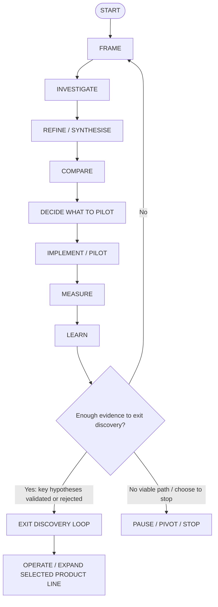

# Etsy Digital Products

**Product discovery, launch and continuous learning**

We are building a digital-products business on Etsy, based in Brazil and aimed at international buyers.

> **Initial objective: find products that attract real buyers and can be produced profitably and repeatedly.**

We already have several product directions. The work now is to identify the strongest opportunities, test them with small pilots and use real buyer behaviour to decide what deserves further investment.

## Current directions

- Small-business / café / gastronomy resources
- Invitations and celebration products
- Bilingual children and family learning materials
- Catholic / faith-based digital products
- Colouring / creative products
- Any stronger opportunity uncovered during research

The first three have already been screened. Café/gastronomy and bilingual learning currently show promising signals; generic invitations show very high demand but also very heavy competition. Catholic and colouring products are newer candidates and still need equivalent screening. See [Market & Demand](research/market-demand.md).

## Discovery and validation

The loop is temporary. We iterate rapidly while important product, buyer and economics hypotheses remain unresolved. We exit discovery when the evidence is sufficient to select the product line(s) we want to operate, or when a candidate is rejected.

After exit, normal business improvement continues, but we are no longer repeating a full new-business discovery cycle.

## Current position

We are in the first **FRAME → INVESTIGATE** cycle.

| Direction | Current signal | Next evidence |
|---|---|---|
| Café / gastronomy | Promising specific sub-niches; generic food-menu terms are more crowded | Official Etsy search data, reviews, bundle economics |
| Invitations / celebrations | Very large demand; very heavy competition | Long-tail occasions, cultural/language needs, review gaps |
| Bilingual learning | Promising Spanish-English signal; low unit prices | Official demand, bundle potential, educational quality |
| Catholic / faith-based | Large visible Etsy supply/activity | Demand screening and review analysis |
| Colouring / creative | Interesting production direction | Specific buyer/use case and demand screening |

## Repository

| Section | Purpose |
|---|---|
| [Opportunity](research/opportunity.md) | Current opportunity thesis and product directions |
| [Market & Demand](research/market-demand.md) | Existing demand/competition evidence and official search plan |
| [Competitors](research/competitors.md) | Real shops and customer/review research |
| [Economics](research/economics.md) | Fees, price sensitivity and unit economics |
| [Platform Feasibility](research/platform-feasibility.md) | Brazil, payments, delivery, search, Canva and AI |
| [Product Shortlist](launch/product-shortlist.md) | Candidates that survive research |
| [Pilot](launch/pilot.md) | Controlled product tests and discovery exit |
| [Measurement](launch/measurement.md) | Evidence collected after launch |
| [Decision Log](decisions/decision-log.md) | Material decisions |
| [References](references.md) | IEEE-style source list |

## Next action

Use Etsy Marketplace Insights to verify the strongest screening signals, then connect those results to competitor reviews and economics before selecting the first pilot products. [[1]](references.md#ref-1)

[Home](README.md) · [Opportunity](research/opportunity.md) · [Market & Demand](research/market-demand.md) · [Competitors](research/competitors.md) · [Economics](research/economics.md) · [Platform Feasibility](research/platform-feasibility.md) · [Shortlist](launch/product-shortlist.md) · [Pilot](launch/pilot.md) · [Measurement](launch/measurement.md) · [Decisions](decisions/decision-log.md) · [References](references.md)
