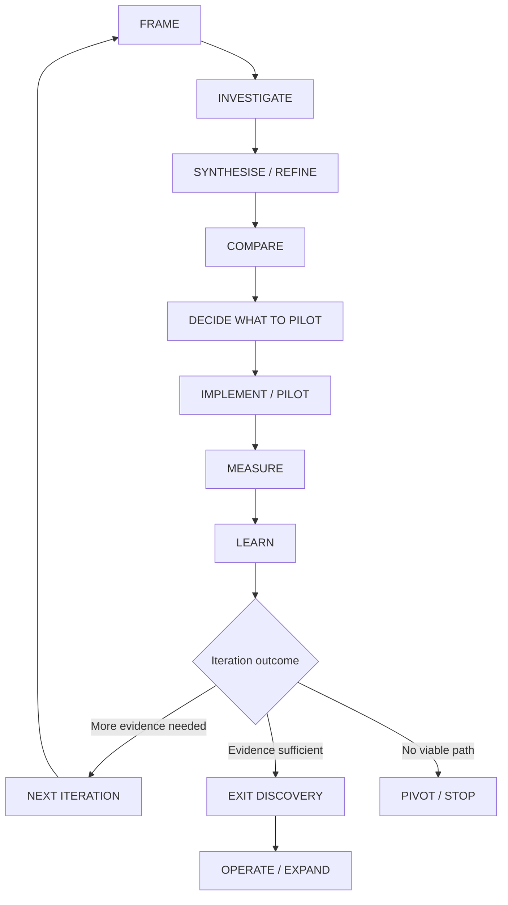

# Etsy Digital Products

**Decision knowledge base for product discovery, validation and launch**

We are building a digital-products business on Etsy, based in Brazil and aimed at international buyers.

> **Initial objective: find products that attract real buyers and can be produced profitably and repeatedly.**

## Current decision

**Iteration 01 is in INVESTIGATE. No pilot has been selected yet.**

All five categories now have substantive research. The next step is **not more general brainstorming**: it is to validate the most decision-relevant searches in Etsy Marketplace Insights, deepen critical-review evidence and inspect a small set of competitor products first-hand.

## Fast status

| Category | Where we are | What matters next |
|---|---|---|
| Invitations / Celebrations | Strong demand and competitor evidence; broad terms very competitive | Validate narrower searches; mine critical reviews; inspect a coordinated/specialist bundle |
| Café / Gastronomy / Bakery | Interesting `coffee menu` / `matcha menu` screening; buyer evidence thinner | Validate café/bakery terms; strengthen menu-specific reviews; compare simple vs multi-layout/business kit |
| Bilingual Children / Family | Interesting Spanish search signals and clear bundle/system models | Validate `spanish alphabet`/worksheets; collect Spanish-specific feedback; quantify QA/bundle economics |
| Catholic / Faith | Concrete product-use and instruction insights | Validate prayer/communion searches; investigate bilingual/sacramental demand; compare concise guide vs activity |
| Colouring / Creative | Strong demand/competitor/review evidence with three clear production models | Validate keywords; buy/inspect representative products; estimate realistic original-art throughput |

## Immediate next actions

1. Run the **15 exact Marketplace Insights searches** in [Market & demand](discovery/iteration-01/market-demand.md).
2. Complete only the remaining RankHero lookups that could materially change a category view.
3. Mine **1–3-star reviews deliberately**, not only Etsy's suggested positive reviews.
4. With Débora, choose a small set of **competitor products worth buying** from the linked shortlist in [Competitors](discovery/iteration-01/competitors.md).
5. Inspect purchase → download → instructions → edit/use → export/print → overall value.
6. Add realistic production effort to [Product economics](discovery/iteration-01/product-economics.md).
7. Update [Opportunity assessment](discovery/iteration-01/opportunity-assessment.md) and [Product comparison](discovery/iteration-01/product-comparison.md); only then select the pilot.

## Discovery process

## Process → BoK

| Process step | Artefact | Practical question |
|---|---|---|
| **FRAME** | [Opportunity frame](discovery/iteration-01/opportunity-frame.md) | What exactly are we trying to determine? |
| **INVESTIGATE** | [Market & demand](discovery/iteration-01/market-demand.md) · [Competitors](discovery/iteration-01/competitors.md) · [Product economics](discovery/iteration-01/product-economics.md) | What does the evidence say? |
| **SYNTHESISE / REFINE** | [Opportunity assessment](discovery/iteration-01/opportunity-assessment.md) | What does the evidence mean? |
| **COMPARE** | [Product comparison](discovery/iteration-01/product-comparison.md) | How do the alternatives compare? |
| **DECIDE** | [Pilot decision](discovery/iteration-01/pilot-decision.md) | What will we test first? |
| **IMPLEMENT / PILOT** | [Pilot plan](discovery/iteration-01/pilot-plan.md) | How will we test it? |
| **MEASURE** | [Measurement](discovery/iteration-01/measurement.md) | What actually happened? |
| **LEARN** | [Learning review](discovery/iteration-01/learning-review.md) | What did we learn? |
| **ITERATE / EXIT** | [Iteration outcome](discovery/iteration-01/iteration-outcome.md) | Continue, operate/expand, pivot or stop? |

## Direct access

- **Decision question / definitions:** [Opportunity frame](discovery/iteration-01/opportunity-frame.md)
- **All search strings, RankHero metrics and Etsy Insights:** [Market & demand](discovery/iteration-01/market-demand.md)
- **All shops, representative listings, reviews and products to consider buying:** [Competitors](discovery/iteration-01/competitors.md)
- **Fees, price signals, contribution illustrations and production economics:** [Product economics](discovery/iteration-01/product-economics.md)
- **What the evidence currently means:** [Opportunity assessment](discovery/iteration-01/opportunity-assessment.md)
- **Fast five-category comparison:** [Product comparison](discovery/iteration-01/product-comparison.md)

## Shared knowledge

- [Platform baseline](knowledge/platform-baseline.md)
- [Economics baseline](knowledge/economics-baseline.md)
- [Channel options](knowledge/channel-options.md)
- [Risk baseline](knowledge/risk-baseline.md)
- [References](knowledge/references.md)

[Process](process-map.md) · [Iteration 01](discovery/iteration-01/opportunity-frame.md) · [Decisions](decisions/strategic-decision-log.md)
