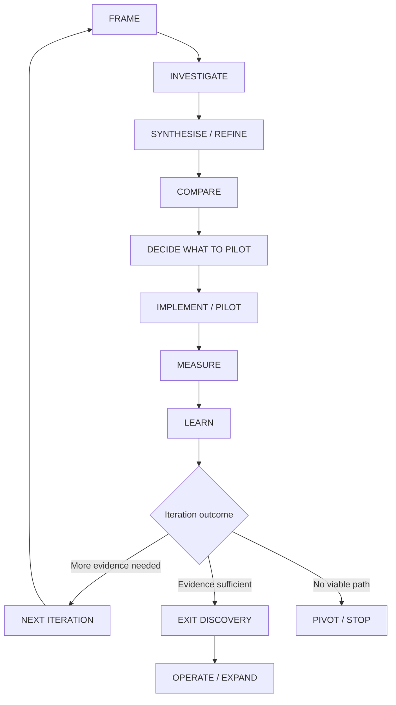

# Etsy Digital Products

**Decision knowledge base for product discovery, validation and launch**

We are building a digital-products business on Etsy, based in Brazil and aimed at international buyers.

> **Initial objective: find products that attract real buyers and can be produced profitably and repeatedly.**

## Current decision

**Iteration 01 is in INVESTIGATE. No pilot has been selected yet.**

All five product directions — **invitations / celebrations, café / gastronomy / bakery, bilingual children / family learning, Catholic / faith-based, and colouring / creative** — remain under investigation. Search discovery, competitor/product research and buyer-review analysis are now substantive across all five categories. No opportunity has been selected or deprioritised at this stage.

## Opportunity status

| Opportunity | What we know now | What is still unresolved | Details |
|---|---|---|---|
| **Invitations / celebrations** | Demand is clearly large across wedding, birthday and baby-shower searches. The competitor set covers coordinated suites, large themed bundles and culturally specific offers, with substantial positive review evidence. | Broad searches are highly competitive. The selected searches still need Etsy Marketplace Insights validation, and the current review sample is thinner on critical product feedback about editing, mobile use, resizing, printing and instructions. | [Demand](discovery/iteration-01/market-demand.md#invitations--celebrations) · [Competitors](discovery/iteration-01/competitors.md#invitations--celebrations) · [Assessment](discovery/iteration-01/opportunity-assessment.md#invitations--celebrations) |
| **Café / gastronomy / bakery** | `coffee menu` and `matcha menu` produced interesting screening signals. Relevant competitors now cover a focused menu, a multi-layout offer and a broader business-resource model. | Bakery and broader café searches have less demand evidence, and product-specific menu reviews are still thinner than in the stronger categories. We need more buyer evidence on editing, sizing, printing, updating prices/branding, instructions and actual business usefulness. | [Demand](discovery/iteration-01/market-demand.md#café--gastronomy--bakery) · [Competitors](discovery/iteration-01/competitors.md#café--gastronomy--bakery) · [Assessment](discovery/iteration-01/opportunity-assessment.md#café--gastronomy--bakery) |
| **Bilingual children / family learning** | Spanish flashcard/alphabet searches produced strong screening signals. Competitors show both smaller thematic resources and large worksheet/learning systems. | More reviews specifically tied to Spanish/bilingual products are needed, together with Etsy validation of the selected searches, evidence on Portuguese-English demand and clearer QA/bundle economics. | [Demand](discovery/iteration-01/market-demand.md#bilingual-children--family-learning) · [Competitors](discovery/iteration-01/competitors.md#bilingual-children--family-learning) · [Assessment](discovery/iteration-01/opportunity-assessment.md#bilingual-children--family-learning) |
| **Catholic / faith-based** | Product/review research has produced concrete buyer-use insights around portability, concise information, easy printing, clear instructions and children's activities. An initial bilingual-use signal has also been identified. | The selected prayer/communion searches still need Etsy validation. Evidence is also thinner on the size of bilingual/sacramental demand, critical reviews and value across single-sheet resources versus larger products/bundles. | [Demand](discovery/iteration-01/market-demand.md#catholic--faith-based) · [Competitors](discovery/iteration-01/competitors.md#catholic--faith-based) · [Assessment](discovery/iteration-01/opportunity-assessment.md#catholic--faith-based) |
| **Colouring / creative** | Search, competitor and review evidence is substantial. Three concrete production models are now documented: larger catalogue/frequent releases, very small original hand-drawn catalogue, and recognisable branded product families. | The selected searches still need Etsy validation. Narrower hand-drawn searches, critical feedback on line quality/resolution/printing/tablet use and realistic original-art production effort remain less clear. | [Demand](discovery/iteration-01/market-demand.md#colouring--creative) · [Competitors](discovery/iteration-01/competitors.md#colouring--creative) · [Assessment](discovery/iteration-01/opportunity-assessment.md#colouring--creative) |

## Immediate next actions

1. When available, use **Etsy Marketplace Insights** to validate the selected searches and add the results to [Market & demand](discovery/iteration-01/market-demand.md).
2. Continue the current [Competitor analysis](discovery/iteration-01/competitors.md), focusing on the category-specific evidence gaps documented in [Opportunity assessment](discovery/iteration-01/opportunity-assessment.md#research-gaps--exact-meaning).

Representative products, direct Etsy links and the reasons for selecting them are already documented in [Competitors](discovery/iteration-01/competitors.md#purchase-decision-shortlist).

## Discovery process

## Process → BoK

| Process step | Artefact |
|---|---|
| **FRAME** | [Opportunity frame](discovery/iteration-01/opportunity-frame.md) |
| **INVESTIGATE** | [Market & demand](discovery/iteration-01/market-demand.md) · [Competitors](discovery/iteration-01/competitors.md) · [Product economics](discovery/iteration-01/product-economics.md) |
| **SYNTHESISE / REFINE** | [Opportunity assessment](discovery/iteration-01/opportunity-assessment.md) |
| **COMPARE** | [Product comparison](discovery/iteration-01/product-comparison.md) |
| **DECIDE** | [Pilot decision](discovery/iteration-01/pilot-decision.md) |
| **IMPLEMENT / PILOT** | [Pilot plan](discovery/iteration-01/pilot-plan.md) |
| **MEASURE** | [Measurement](discovery/iteration-01/measurement.md) |
| **LEARN** | [Learning review](discovery/iteration-01/learning-review.md) |
| **ITERATE / EXIT** | [Iteration outcome](discovery/iteration-01/iteration-outcome.md) |

## Shared knowledge

- [Platform baseline](knowledge/platform-baseline.md)
- [Economics baseline](knowledge/economics-baseline.md)
- [Channel options](knowledge/channel-options.md)
- [Risk baseline](knowledge/risk-baseline.md)
- [References](knowledge/references.md)

[Process](process-map.md) · [Iteration 01](discovery/iteration-01/opportunity-frame.md) · [Decisions](decisions/strategic-decision-log.md)
