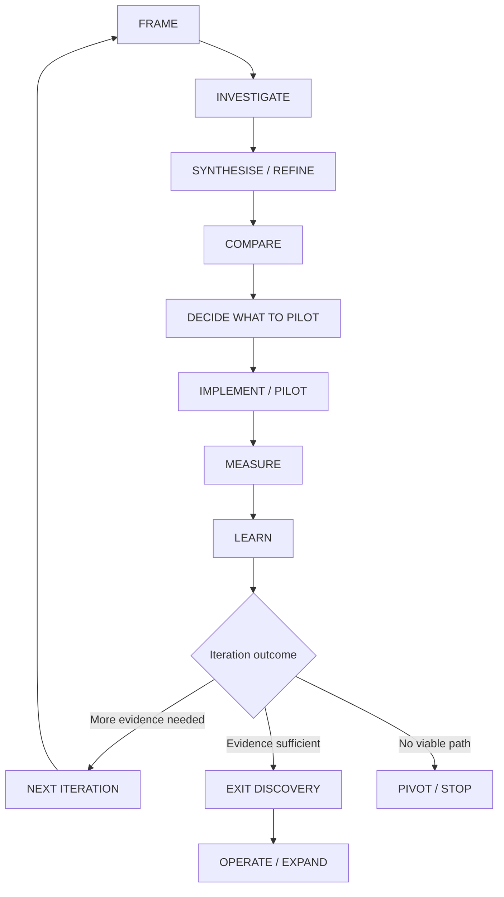

# Etsy Digital Products

**Decision knowledge base for product discovery, validation and launch**

We are building a digital-products business on Etsy, based in Brazil and aimed at international buyers.

> **Initial objective: find products that attract real buyers and can be produced profitably and repeatedly.**

## Current decision

**Iteration 01 is in INVESTIGATE. No pilot has been selected yet.**

All five product directions — **invitations / celebrations, café / gastronomy / bakery, bilingual children / family learning, Catholic / faith-based, and colouring / creative** — remain under investigation. Search discovery, competitor/product research and buyer-review analysis have been completed to different depths across all five categories. No opportunity has been selected or deprioritised at this stage.

## Opportunity status

| Opportunity | What we know now | Evidence not yet collected | Details |
|---|---|---|---|
| **Invitations / celebrations** | RankHero screening reports approximately 301k monthly searches for `wedding invitation`, 90.5k for `birthday invitations` and 40.5k for `baby shower invites`, alongside high reported competition for the broad terms. Competitor research covers coordinated suites, themed bundles and culturally specific offers, with buyer-review evidence already collected. | Etsy Marketplace Insights results for the selected searches; a larger sample of critical product reviews covering editing, mobile use, resizing, printing and instructions. | [Demand](discovery/iteration-01/market-demand.md#invitations--celebrations) · [Competitors](discovery/iteration-01/competitors.md#invitations--celebrations) · [Assessment](discovery/iteration-01/opportunity-assessment.md#invitations--celebrations) |
| **Café / gastronomy / bakery** | RankHero reports approximately 18k–22k monthly searches and 4,368 competition for `coffee menu`, and approximately 4.4k monthly searches and 191 competition for `matcha menu`. Current competitors represent a focused menu, a multi-layout offer and a broader business-resource model. | More demand evidence for bakery and broader café searches; more product-specific menu reviews covering editing, sizing, printing, price/branding updates, instructions and business use. | [Demand](discovery/iteration-01/market-demand.md#café--gastronomy--bakery) · [Competitors](discovery/iteration-01/competitors.md#café--gastronomy--bakery) · [Assessment](discovery/iteration-01/opportunity-assessment.md#café--gastronomy--bakery) |
| **Bilingual children / family learning** | RankHero reports approximately 6.6k monthly searches and 3.1k competition for `spanish flashcards`, and approximately 135k monthly searches and 1.7k competition for `spanish alphabet`. Competitors represent both smaller thematic resources and large worksheet/learning systems. | Etsy Marketplace Insights results for the selected searches; more reviews specifically tied to Spanish/bilingual products; Portuguese-English demand evidence; clearer QA and bundle-economics evidence. | [Demand](discovery/iteration-01/market-demand.md#bilingual-children--family-learning) · [Competitors](discovery/iteration-01/competitors.md#bilingual-children--family-learning) · [Assessment](discovery/iteration-01/opportunity-assessment.md#bilingual-children--family-learning) |
| **Catholic / faith-based** | RankHero reports approximately 60.5k monthly searches for `catholic prayer`, 18.1k for `prayer cards` and 8.1k for `bible coloring pages`. Product/review research has identified buyer-use themes around portability, concise information, easy printing, instructions and children's activities, plus one bilingual-use signal. | Etsy Marketplace Insights results for the selected prayer/communion searches; broader evidence on bilingual and sacramental demand; more critical reviews; further comparison of single-resource versus bundle value. | [Demand](discovery/iteration-01/market-demand.md#catholic--faith-based) · [Competitors](discovery/iteration-01/competitors.md#catholic--faith-based) · [Assessment](discovery/iteration-01/opportunity-assessment.md#catholic--faith-based) |
| **Colouring / creative** | RankHero reports approximately 110k monthly searches and 82k competition for `cute coloring pages`, 33k–40k monthly searches and 31k–53k competition for `cozy coloring book`, and 135k monthly searches and 512k competition for `printable coloring pages`. Three production models are documented: larger catalogue/frequent releases, small original hand-drawn catalogue, and recognisable branded product families. | Etsy Marketplace Insights results for the selected searches; narrower hand-drawn search evidence; more critical feedback on line quality, resolution, printing and tablet use; additional evidence on original-art production effort. | [Demand](discovery/iteration-01/market-demand.md#colouring--creative) · [Competitors](discovery/iteration-01/competitors.md#colouring--creative) · [Assessment](discovery/iteration-01/opportunity-assessment.md#colouring--creative) |

## Next actions

- Continue the current [Competitor analysis](discovery/iteration-01/competitors.md).
- When available, use **Etsy Marketplace Insights** to validate the selected searches and add the results to [Market & demand](discovery/iteration-01/market-demand.md).

Representative products, direct Etsy links and the reasons for selecting them are documented in [Competitors](discovery/iteration-01/competitors.md#representative-product-shortlist).

## Discovery process

## Process → BoK

| Process step | Artefact |
|---|---|
| **FRAME** | [Opportunity frame](discovery/iteration-01/opportunity-frame.md) |
| **INVESTIGATE** | [Market & demand](discovery/iteration-01/market-demand.md) · [Competitors](discovery/iteration-01/competitors.md) · [Product economics](discovery/iteration-01/product-economics.md) |
| **SYNTHESISE / REFINE** | [Opportunity assessment](discovery/iteration-01/opportunity-assessment.md) |
| **COMPARE** | [Product comparison](discovery/iteration-01/product-comparison.md) |
| **DECIDE** | [Pilot decision](discovery/iteration-01/pilot-decision.md) |
| **IMPLEMENT / PILOT** | [Pilot plan](discovery/iteration-01/pilot-plan.md) |
| **MEASURE** | [Measurement](discovery/iteration-01/measurement.md) |
| **LEARN** | [Learning review](discovery/iteration-01/learning-review.md) |
| **ITERATE / EXIT** | [Iteration outcome](discovery/iteration-01/iteration-outcome.md) |

## Shared knowledge

- [Platform baseline](knowledge/platform-baseline.md)
- [Economics baseline](knowledge/economics-baseline.md)
- [Channel options](knowledge/channel-options.md)
- [Risk baseline](knowledge/risk-baseline.md)
- [References](knowledge/references.md)

[Process](process-map.md) · [Iteration 01](discovery/iteration-01/opportunity-frame.md) · [Decisions](decisions/strategic-decision-log.md)
