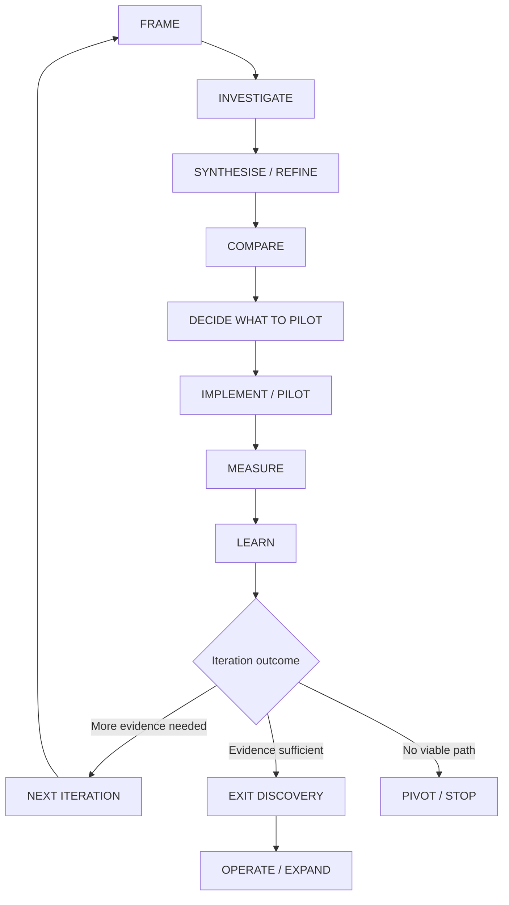

# Etsy Digital Products

**Decision knowledge base for product discovery, validation and launch**

We are building a digital-products business on Etsy, based in Brazil and aimed at international buyers.

> **Initial objective: find products that attract real buyers and can be produced profitably and repeatedly.**

## Current decision

**Iteration 01 is in INVESTIGATE. No pilot has been selected yet.**

Current strongest signals are in **café / matcha** and **Spanish-English learning**. Generic invitations show strong demand but much heavier competition. Catholic and colouring opportunities still lack enough evidence for a fair comparison.

## Opportunity status

| Opportunity | Current signal | Evidence level | Main gap | Next action |
|---|---|---|---|---|
| Café / small-business | Strongest current screening; `coffee menu` and `matcha menu` look promising | Medium | Need Etsy Marketplace Insights + café-specific competitor/review evidence | Validate keywords; find 3–5 relevant café/menu shops |
| Bilingual learning | Promising demand/competition signal for `spanish flashcards` | Medium | Need deeper competitor/review evidence and bundle economics | Validate keywords; find 3–5 bilingual-learning shops |
| Invitations / celebrations | Demand clearly proven | Medium | Broad market is highly saturated; need a narrower entry point | Review cultural/bilingual/occasion niches and bundle gaps |
| Catholic / faith-based | Existing Etsy activity visible | Low | No comparable demand, pricing or competitor analysis yet | Run keyword screen; find 3–5 relevant shops |
| Colouring / creative | Production idea only | Low | Buyer/use case still too broad | Define one concrete colouring use case before deeper research |

## Immediate next actions

1. Run the planned **15 Marketplace Insights searches** and record the results in [Market & demand](discovery/iteration-01/market-demand.md).
2. Expand [Competitors](discovery/iteration-01/competitors.md), especially for **café, bilingual and Catholic** products.
3. From the strongest current opportunities, identify **1–2 competitor products worth buying** to inspect the full customer experience: purchase → download → instructions → edit/use → final result.
4. Mine recent reviews for recurring problems, requests and missing bundle elements.
5. Update [Opportunity assessment](discovery/iteration-01/opportunity-assessment.md) and [Product comparison](discovery/iteration-01/product-comparison.md). Only then select the pilot.

## Discovery process

## Process → BoK

| Process step | Artefact |
|---|---|
| **FRAME** | [Opportunity frame](discovery/iteration-01/opportunity-frame.md) |
| **INVESTIGATE** | [Market & demand](discovery/iteration-01/market-demand.md) · [Competitors](discovery/iteration-01/competitors.md) · [Product economics](discovery/iteration-01/product-economics.md) |
| **SYNTHESISE / REFINE** | [Opportunity assessment](discovery/iteration-01/opportunity-assessment.md) |
| **COMPARE** | [Product comparison](discovery/iteration-01/product-comparison.md) |
| **DECIDE** | [Pilot decision](discovery/iteration-01/pilot-decision.md) |
| **IMPLEMENT / PILOT** | [Pilot plan](discovery/iteration-01/pilot-plan.md) |
| **MEASURE** | [Measurement](discovery/iteration-01/measurement.md) |
| **LEARN** | [Learning review](discovery/iteration-01/learning-review.md) |
| **ITERATE / EXIT** | [Iteration outcome](discovery/iteration-01/iteration-outcome.md) |

## Shared knowledge

- [Platform baseline](knowledge/platform-baseline.md)
- [Economics baseline](knowledge/economics-baseline.md)
- [Channel options](knowledge/channel-options.md)
- [Risk baseline](knowledge/risk-baseline.md)
- [References](knowledge/references.md)

[Process](process-map.md) · [Iteration 01](discovery/iteration-01/opportunity-frame.md) · [Decisions](decisions/strategic-decision-log.md)
