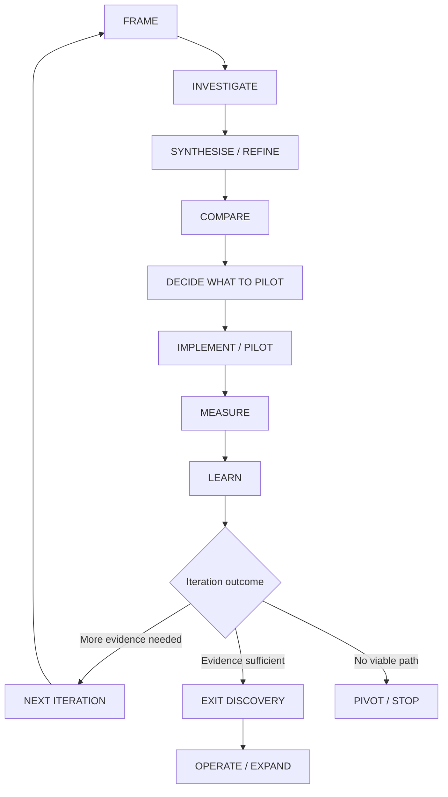

# Etsy Digital Products

**Decision knowledge base for product discovery, validation and launch**

We are building a digital-products business on Etsy, based in Brazil and aimed at international buyers.

> **Initial objective: find products that attract real buyers and can be produced profitably and repeatedly.**

## Current decision

**Iteration 01 is in INVESTIGATE. Pilot selection remains open.**

All five product directions — **invitations / celebrations, café / gastronomy / bakery, bilingual children / family learning, Catholic / faith-based, and colouring / creative** — remain under investigation. Search discovery, competitor/product research and buyer-review analysis have been completed to different depths across all five categories. All five opportunities remain open for comparison.

## Opportunity status

Select an opportunity for its assessment, or use the **Demand** and **Competitors** links for the underlying evidence.

| Opportunity | Current signal | Additional evidence |
|---|---|---|
| **[Invitations / celebrations](discovery/iteration-01/opportunity-assessment.md#invitations--celebrations)** [Demand](discovery/iteration-01/market-demand.md#invitations--celebrations) · [Competitors](discovery/iteration-01/competitors.md#invitations--celebrations) | **Large demand, crowded broad market.** Search and competitor evidence show substantial buyer activity, while generic invitation searches are highly competitive. Current research points toward narrower occasion, cultural and coordinated product-family propositions. | Etsy Marketplace Insights and additional critical product reviews could help distinguish which narrower segments and buyer problems are most useful to investigate further. |
| **[Café / gastronomy / bakery](discovery/iteration-01/opportunity-assessment.md#café--gastronomy--bakery)** [Demand](discovery/iteration-01/market-demand.md#café--gastronomy--bakery) · [Competitors](discovery/iteration-01/competitors.md#café--gastronomy--bakery) | **Focused niche potential.** Current screening shows measurable demand for café/menu products, with relatively low reported competition in some specific searches. Competitors demonstrate focused menus, multi-layout offers and broader business-resource families. | Broader café/bakery search evidence and more product-specific buyer feedback could help compare the relative potential of those product models. |
| **[Bilingual children / family learning](discovery/iteration-01/opportunity-assessment.md#bilingual-children--family-learning)** [Demand](discovery/iteration-01/market-demand.md#bilingual-children--family-learning) · [Competitors](discovery/iteration-01/competitors.md#bilingual-children--family-learning) | **Promising search signals with repeatable product-family potential.** Competitors demonstrate both smaller thematic resources and larger learning systems/bundles. Price levels and language/educational QA are important to the economics. | More product-specific bilingual reviews, Portuguese-English evidence and QA/production estimates could improve the comparison between small resources and larger systems. |
| **[Catholic / faith-based](discovery/iteration-01/opportunity-assessment.md#catholic--faith-based)** [Demand](discovery/iteration-01/market-demand.md#catholic--faith-based) · [Competitors](discovery/iteration-01/competitors.md#catholic--faith-based) | **Clear buyer use cases with several possible product directions.** Review evidence identifies needs around concise guidance, portability, easy printing, instructions and children's/family use. | Additional search, review and format/value evidence could help distinguish the relative potential of prayer, sacramental, bilingual and children's directions. |
| **[Colouring / creative](discovery/iteration-01/opportunity-assessment.md#colouring--creative)** [Demand](discovery/iteration-01/market-demand.md#colouring--creative) · [Competitors](discovery/iteration-01/competitors.md#colouring--creative) | **One of the most developed product-model comparisons.** Three distinct approaches are already documented: larger catalogues/frequent releases, small original hand-drawn catalogues and recognisable branded product families. | Narrower hand-drawn search evidence, technical buyer feedback and production-effort estimates could clarify the trade-off between originality, catalogue breadth and production economics. |

## Next actions

- Continue the current [Competitor analysis](discovery/iteration-01/competitors.md).
- When available, use **Etsy Marketplace Insights** to validate the selected searches and add the results to [Market & demand](discovery/iteration-01/market-demand.md).

Representative products, direct Etsy links and the reasons for selecting them are documented in [Competitors](discovery/iteration-01/competitors.md#representative-product-shortlist).

## Discovery process

## Process → BoK

| Process step | Artefact |
|---|---|
| **FRAME** | [Opportunity frame](discovery/iteration-01/opportunity-frame.md) |
| **INVESTIGATE** | [Market & demand](discovery/iteration-01/market-demand.md) · [Competitors](discovery/iteration-01/competitors.md) · [Product economics](discovery/iteration-01/product-economics.md) |
| **SYNTHESISE / REFINE** | [Opportunity assessment](discovery/iteration-01/opportunity-assessment.md) |
| **COMPARE** | [Product comparison](discovery/iteration-01/product-comparison.md) |
| **DECIDE** | [Pilot decision](discovery/iteration-01/pilot-decision.md) |
| **IMPLEMENT / PILOT** | [Pilot plan](discovery/iteration-01/pilot-plan.md) |
| **MEASURE** | [Measurement](discovery/iteration-01/measurement.md) |
| **LEARN** | [Learning review](discovery/iteration-01/learning-review.md) |
| **ITERATE / EXIT** | [Iteration outcome](discovery/iteration-01/iteration-outcome.md) |

## Shared knowledge

- [Platform baseline](knowledge/platform-baseline.md)
- [Economics baseline](knowledge/economics-baseline.md)
- [Channel options](knowledge/channel-options.md)
- [Risk baseline](knowledge/risk-baseline.md)
- [References](knowledge/references.md)

[Process](process-map.md) · [Iteration 01](discovery/iteration-01/opportunity-frame.md) · [Decisions](decisions/strategic-decision-log.md)
