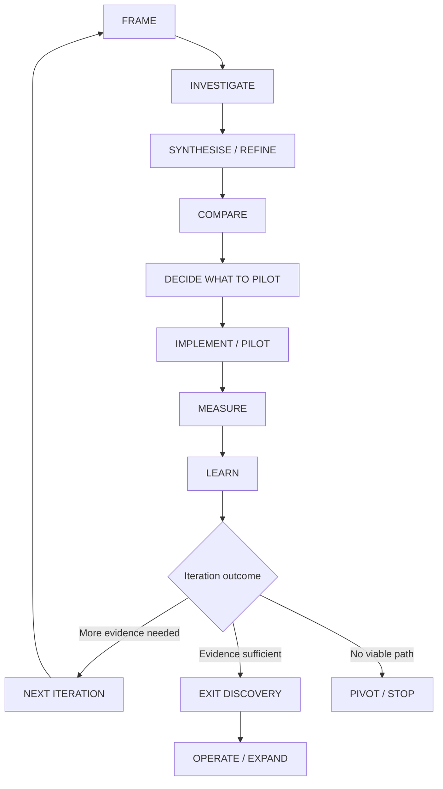

# Etsy Digital Products

**Decision knowledge base for product discovery, validation and launch**

We are building a digital-products business on Etsy, based in Brazil and aimed at international buyers.

> **Initial objective: find products that attract real buyers and can be produced profitably and repeatedly.**

## Current decision

**Iteration 01 is in INVESTIGATE. No pilot has been selected yet.**

All five product directions — **invitations / celebrations, café / gastronomy / bakery, bilingual children / family learning, Catholic / faith-based, and colouring / creative** — remain under investigation. The evidence base now includes detailed search discovery, competitor/product evidence and buyer-review evidence across all five. No opportunity has been selected or deprioritised at this stage.

## Opportunity status

| Opportunity | Current signal | Evidence level | Main gap | Next action |
|---|---|---|---|---|
| Invitations / celebrations | Strong demand and strong competitor/product evidence; broad terms are highly competitive | Strong screening / strong competitor evidence | Etsy keyword validation, deliberately collected critical reviews and hands-on bundle evidence | Validate selected searches; mine 1–3-star reviews; inspect a coordinated/specialist product |
| Café / gastronomy / bakery | Interesting `coffee menu` / `matcha menu` screening; buyer evidence is thinner | Good but incomplete | More café/bakery keyword evidence and product-specific menu reviews | Validate café/bakery terms; strengthen menu-specific review evidence; compare simple vs multi-layout/business-kit offers |
| Bilingual children / family | Interesting Spanish search signals and clear bundle/system models | Strong screening / good competitor evidence | Spanish-specific reviews, Etsy validation, Portuguese-English demand and QA/bundle economics | Validate selected searches; deepen product-specific reviews; compare small-resource vs large-system economics |
| Catholic / faith-based | Concrete product-use, portability and instruction insights | Good / actionable | Direct keyword validation, broader bilingual/sacramental evidence and more critical reviews | Validate prayer/communion searches; compare concise guide vs activity/bundle models |
| Colouring / creative | Strong search, competitor and review evidence with three distinct production models | Strong | Keyword validation, critical reviews, hands-on product analysis and original-art throughput | Validate searches; inspect representative products; estimate realistic hand-drawn production effort |

## Immediate next actions

1. Complete the remaining **RankHero lookups** that could materially change the category view.
2. Run the planned **15 Etsy Marketplace Insights searches** and record the results in [Market & demand](discovery/iteration-01/market-demand.md).
3. Refine the search set and identify recurring shops across the validated searches.
4. Mine **critical / 1–3-star reviews deliberately**, not only positive review evidence.
5. With Débora, select a small set of high-learning-value competitor products from [Competitors](discovery/iteration-01/competitors.md), inspect the full customer experience, and then update [Opportunity assessment](discovery/iteration-01/opportunity-assessment.md) and [Product comparison](discovery/iteration-01/product-comparison.md).

## Discovery process

## Process → BoK

| Process step | Artefact |
|---|---|
| **FRAME** | [Opportunity frame](discovery/iteration-01/opportunity-frame.md) |
| **INVESTIGATE** | [Market & demand](discovery/iteration-01/market-demand.md) · [Competitors](discovery/iteration-01/competitors.md) · [Product economics](discovery/iteration-01/product-economics.md) |
| **SYNTHESISE / REFINE** | [Opportunity assessment](discovery/iteration-01/opportunity-assessment.md) |
| **COMPARE** | [Product comparison](discovery/iteration-01/product-comparison.md) |
| **DECIDE** | [Pilot decision](discovery/iteration-01/pilot-decision.md) |
| **IMPLEMENT / PILOT** | [Pilot plan](discovery/iteration-01/pilot-plan.md) |
| **MEASURE** | [Measurement](discovery/iteration-01/measurement.md) |
| **LEARN** | [Learning review](discovery/iteration-01/learning-review.md) |
| **ITERATE / EXIT** | [Iteration outcome](discovery/iteration-01/iteration-outcome.md) |

## Shared knowledge

- [Platform baseline](knowledge/platform-baseline.md)
- [Economics baseline](knowledge/economics-baseline.md)
- [Channel options](knowledge/channel-options.md)
- [Risk baseline](knowledge/risk-baseline.md)
- [References](knowledge/references.md)

[Process](process-map.md) · [Iteration 01](discovery/iteration-01/opportunity-frame.md) · [Decisions](decisions/strategic-decision-log.md)
