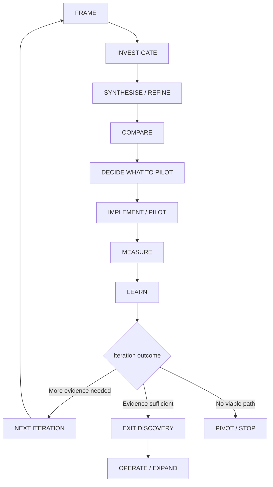

# Etsy Digital Products — Business Decision Knowledge Base

**Purpose:** identify digital products that attract real buyers and can be produced profitably and repeatedly.

This repository is the working **Business Decision Knowledge Base (BoK)** for the Etsy project. It separates reusable platform/economic knowledge from the evidence, analysis, decisions and learning generated by each discovery iteration.

## Current status

**Iteration 01 is active.**

We are comparing five product directions:

- café / small-business resources;
- invitations / celebrations;
- bilingual children / family learning;
- Catholic / faith-based products;
- colouring / creative products.

The first three already have preliminary market evidence. Catholic and colouring products need equivalent screening before a fair comparison.

## Discovery process

The loop is temporary. We iterate while material hypotheses remain unresolved. We exit when the evidence is strong enough to operate/expand a product line, or when we reject the current path.

## Process → BoK traceability

| Process step | Iteration 01 artefact | Purpose | Output |
|---|---|---|---|
| **FRAME** | [opportunity-frame.md](discovery/iteration-01/opportunity-frame.md) | Define the current decision question and scope | Investigation brief |
| **INVESTIGATE** | [market-demand.md](discovery/iteration-01/market-demand.md), [competitors.md](discovery/iteration-01/competitors.md), [product-economics.md](discovery/iteration-01/product-economics.md) | Build evidence | Evidence base |
| **SYNTHESISE / REFINE** | [opportunity-assessment.md](discovery/iteration-01/opportunity-assessment.md) | Turn evidence into an updated opportunity view | Refined candidates |
| **COMPARE** | [product-comparison.md](discovery/iteration-01/product-comparison.md) | Compare surviving candidates on common criteria | Ranked comparison |
| **DECIDE** | [pilot-decision.md](discovery/iteration-01/pilot-decision.md) | Select what will be tested | Pilot decision |
| **IMPLEMENT / PILOT** | [pilot-plan.md](discovery/iteration-01/pilot-plan.md) | Define and execute the test | Live pilot |
| **MEASURE** | [measurement.md](discovery/iteration-01/measurement.md) | Capture observed results | Results |
| **LEARN** | [learning-review.md](discovery/iteration-01/learning-review.md) | Interpret results | Learning |
| **ITERATE / EXIT** | [iteration-outcome.md](discovery/iteration-01/iteration-outcome.md) | Close the iteration | Next frame / operate / pivot / stop |

Full input/output traceability is in [process-map.md](process-map.md).

## Shared knowledge

These files are deliberately **outside** the iteration because they contain rules or assumptions reused across multiple iterations:

- [Platform baseline](knowledge/platform-baseline.md) — Etsy, Brazil/Payoneer, digital delivery, search, AI and Canva constraints.
- [Economics baseline](knowledge/economics-baseline.md) — Etsy fee model and reusable unit-economics logic.
- [References](knowledge/references.md) — IEEE-style source register with direct links.

Iteration-specific economics are applied separately in [product-economics.md](discovery/iteration-01/product-economics.md).

## Immediate work

Iteration 01 is currently at **INVESTIGATE**. The next evidence task is to use Etsy Marketplace Insights to replace or confirm third-party keyword estimates, then complete review/competitor analysis for the strongest candidates. Etsy currently provides 15 free keyword searches per week and shows 30-day search/listing data. [[1]](knowledge/references.md#ref-1)

[Home](README.md) · [Process](process-map.md) · [Platform baseline](knowledge/platform-baseline.md) · [Economics baseline](knowledge/economics-baseline.md) · [Iteration 01](discovery/iteration-01/opportunity-frame.md) · [Strategic decisions](decisions/strategic-decision-log.md) · [References](knowledge/references.md)
