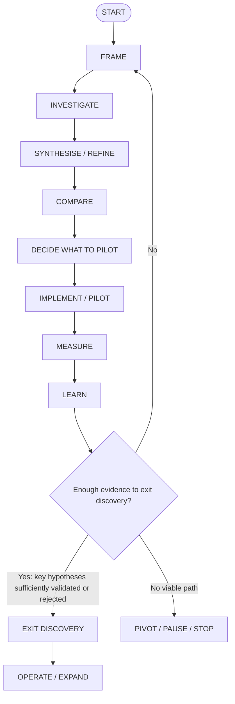

# Etsy Digital Products

**Decision knowledge base for product discovery, validation and launch**

We are building a digital-products business on Etsy, based in Brazil and aimed at international buyers.

> **Initial objective: find products that attract real buyers and can be produced profitably and repeatedly.**

The repository is organised around the decision process. Each process step has a distinct knowledge artefact, so a reader can trace the project from the initial question through evidence, assessment, comparison, decision, pilot and learning.

## Discovery process



Discovery is deliberately iterative, but not permanent. We return to **FRAME** only while important hypotheses remain unresolved. We exit when the evidence is strong enough to operate a selected product line, or when we reject the opportunity.

## Process → knowledge base

| Process step | Primary artefact | What it produces |
|---|---|---|
| **FRAME** | [Opportunity frame](discovery/opportunity-frame.md) | Current question, scope and candidate opportunities |
| **INVESTIGATE** | [Market & demand](discovery/evidence/market-demand.md), [Competitors](discovery/evidence/competitors.md), [Economics](discovery/evidence/economics.md), [Platform feasibility](discovery/evidence/platform-feasibility.md) | Evidence base |
| **SYNTHESISE / REFINE** | [Opportunity assessment](discovery/opportunity-assessment.md) | Evidence-based view of which opportunities remain credible |
| **COMPARE** | [Product comparison](discovery/product-comparison.md) | Side-by-side comparison of surviving candidates |
| **DECIDE** | [Pilot decision](discovery/pilot-decision.md) | Primary family, backup and pilot products |
| **IMPLEMENT / PILOT** | [Pilot plan](pilot/pilot-plan.md) | Controlled market test |
| **MEASURE** | [Measurement](pilot/measurement.md) | Observed buyer and commercial results |
| **LEARN** | [Learning review](pilot/learning-review.md) | Interpretation and iterate/exit recommendation |
| **ITERATE / EXIT** | [Decision log](decisions/decision-log.md) | Formal decision and next state |

For full input/output traceability, see [Process map](process-map.md).

## Current position

We are in the first **FRAME → INVESTIGATE** cycle. The original three directions already have preliminary screening evidence; Catholic and colouring products were added later and need equivalent screening.

| Direction | Current position |
|---|---|
| Café / gastronomy | Strongest preliminary screening signal in specific terms such as `coffee menu` and `matcha menu` |
| Bilingual learning | Promising Spanish-English signal, but low unit prices make bundle economics important |
| Invitations / celebrations | Demand is clearly established, but generic terms are heavily saturated |
| Catholic / faith-based | Active Etsy supply and review activity; demand economics still need direct screening |
| Colouring / creative | Product direction only; buyer/use case still needs to be framed before comparison |

The next evidence step is Etsy Marketplace Insights, followed by targeted review mining and competitor analysis. [[1]](references.md#ref-1)

## Repository structure

```text
etsy-digital-products/
├── README.md
├── process-map.md
├── discovery/
│   ├── opportunity-frame.md
│   ├── evidence/
│   │   ├── market-demand.md
│   │   ├── competitors.md
│   │   ├── economics.md
│   │   └── platform-feasibility.md
│   ├── opportunity-assessment.md
│   ├── product-comparison.md
│   └── pilot-decision.md
├── pilot/
│   ├── pilot-plan.md
│   ├── measurement.md
│   └── learning-review.md
├── decisions/
│   └── decision-log.md
└── references.md
```

[Home](README.md) · [Process map](process-map.md) · [References](references.md)
